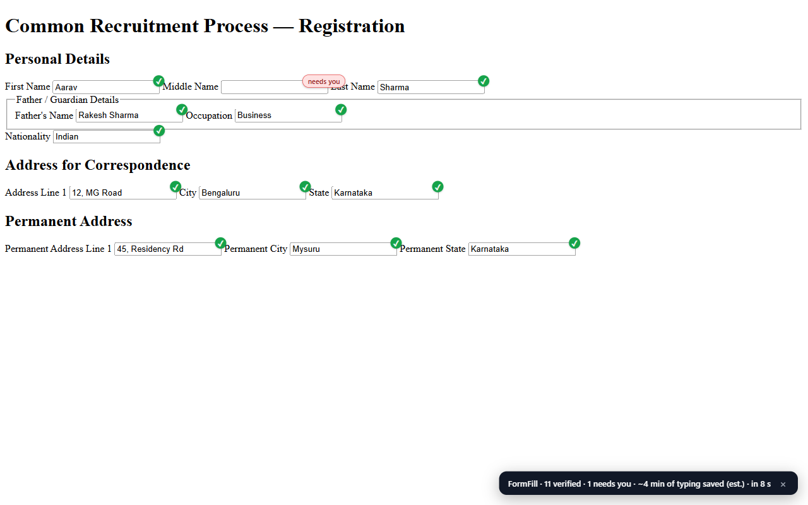
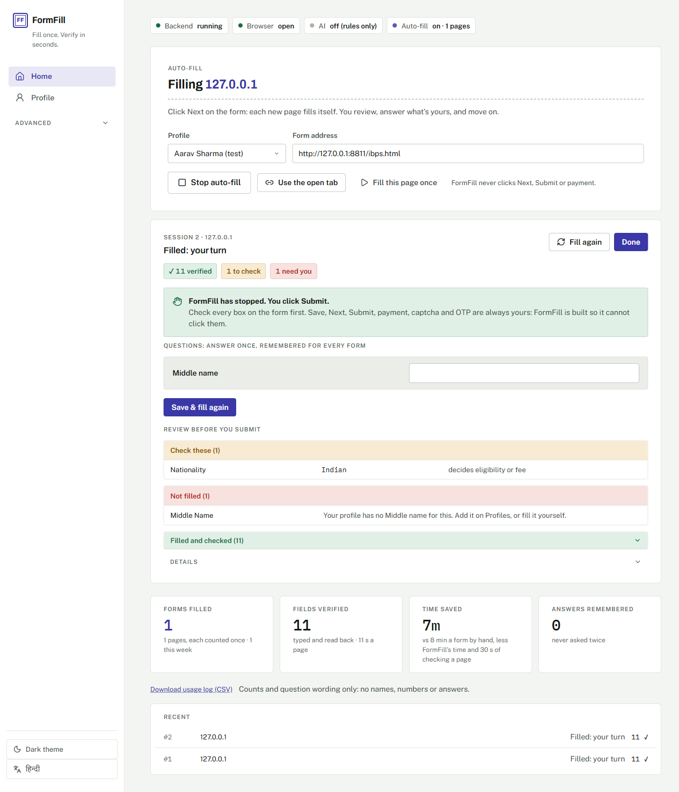

# FormFill

**Fill once. Verify in seconds.**

FormFill fills long Indian application forms (exams, jobs, scholarships) from
details you enter once. It checks every box it fills and marks what's left for
you. **You always type the captcha and OTP, and click Submit yourself.**

In हिन्दी and English: you choose on first use.

## ⬇ [Download FormFill for Windows](https://github.com/sarthakjain572/formfill/releases/latest/download/FormFill-Setup.exe)

Windows 10 or 11 (64-bit) · about 55 MB · free · no account needed

---

## Why

Every year, millions of Indians fill the same details into portal after portal:
name, parents, address, category, marks, photo and signature, typed again for
every exam, job and scholarship. Many pay a cyber café to do it, and one wrong
box can cost the application. FormFill lets the applicants fill their own forms,
on their own device. The goal: any form ready to submit in under 2 minutes.

## What it does

- **Fills each page from your profile**, in your own browser window with your
  own login.
- **Reads back every value** and marks each box on the form: green when it's
  filled and checked, amber when it's a choice only you can make.
- **Never assumes** an answer that decides eligibility or fees (category or
  disability). It asks you once and remembers the answer for every
  form after.
- **Shows a review list before you submit**: what it filled, what to
  double-check, and what it couldn't fill and why.
- **Can't click Save, Next, Submit or Pay**: those clicks are blocked by
  design.
- **Resizes your photo and signature** to each portal's rules.

## Where it works today

Filled end to end on the live portals in our own testing:

| Portal | What was filled |
|---|---|
| **XAT** | the whole application: 6 pages, about 75 fields |
| **SSC** One Time Registration | personal details, every Verify pair matching |
| **BPSC** One Time Registration | all personal fields |

It also reads forms it has never seen before, so other portals usually work too.
[Tell us about a portal](https://github.com/sarthakjain572/formfill/issues)
that doesn't fill well.

**Next: the phone.** Most applicants don't have a PC. The same fill engine has
already filled a live XAT page in Chrome on Android. An Android app, with your
details stored only on the phone, is in testing.

## Install (about 2 minutes)

1. Double-click **FormFill-Setup.exe**.
2. If Windows shows *"Windows protected your PC"*, click **More info**, then
   **Run anyway**. FormFill is new and not yet code-signed.
3. Click **Next**, then **Finish**. FormFill opens by itself.

Nothing else to install: it brings everything it needs, and uses Google
Chrome, or Microsoft Edge if Chrome isn't installed.

## Use it

1. **Choose your language and make your profile:** your details, photo and
   signature, once.
2. **Open your form in the FormFill window:** press Ctrl+T, go to the
   portal, log in and open the application form.
3. **Click Start auto-fill** in the FormFill tab. Every page fills itself.
   Check it, type any captcha or OTP, and click Next or Submit yourself.

Next time, double-click **FormFill** on your desktop.

## Your data

- **It stays on your computer.** FormFill has no server and no account;
  your details go only to the portal you submit to.
- **You decide how long it's kept.** Choose on first use, and use
  **Delete all my data** whenever you want.
- **No AI service needed.** FormFill fills with its own rules.
- **Close the FormFill window** when you're done; that stops FormFill.
- **Update:** FormFill tells you when a new version is out. Run the newest
  FormFill-Setup.exe; your profiles are kept.
- **Uninstall:** Settings → Apps → FormFill → Uninstall. This removes
  FormFill and everything it saved.

## Help and feedback

A form that doesn't fill well, or a portal you'd like supported? Open an
issue: [github.com/sarthakjain572/formfill/issues](https://github.com/sarthakjain572/formfill/issues)

FormFill is in early testing. Check every page before you submit.
